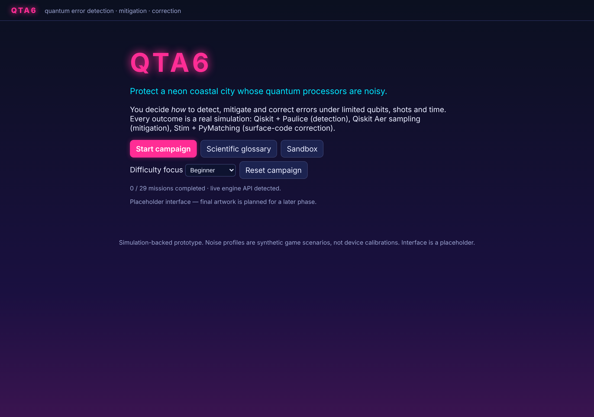
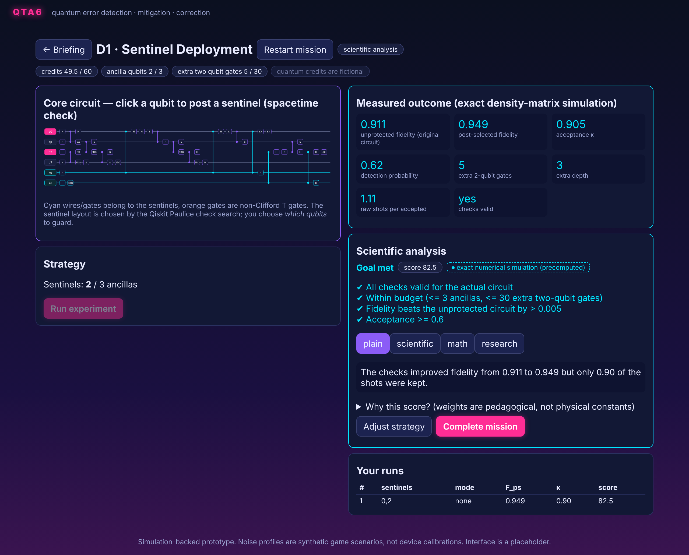
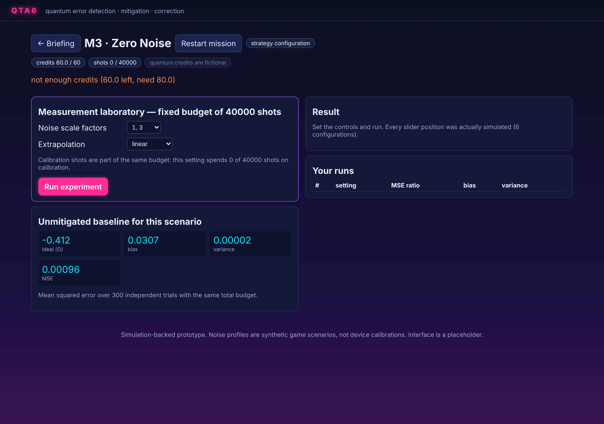
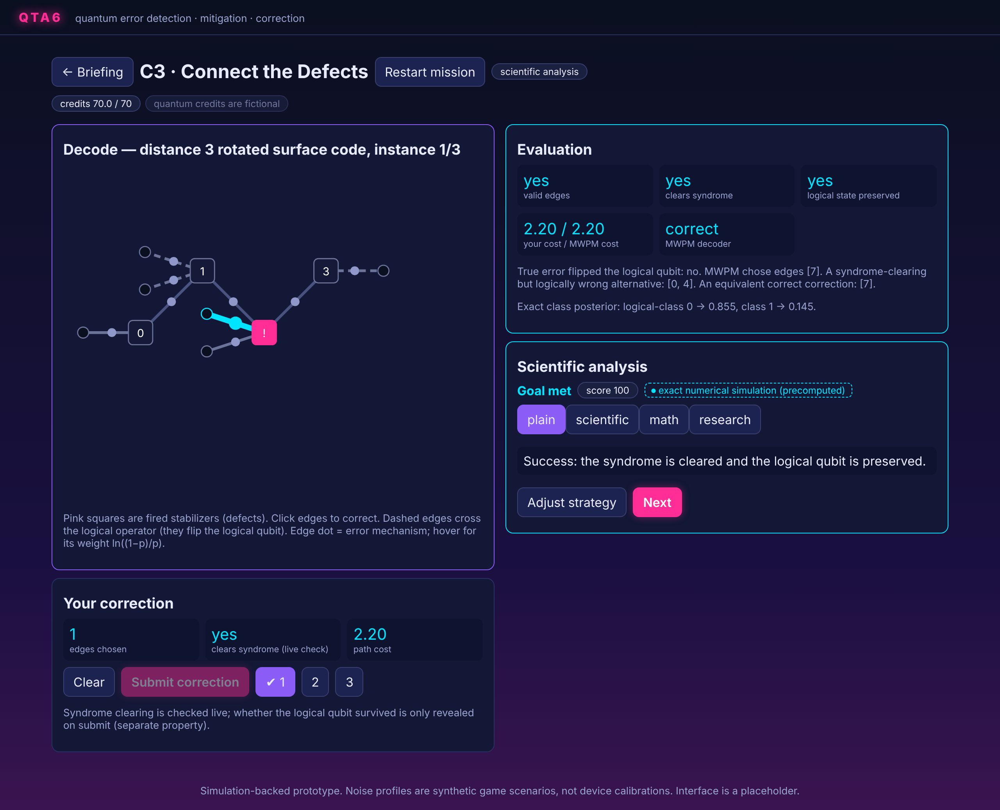
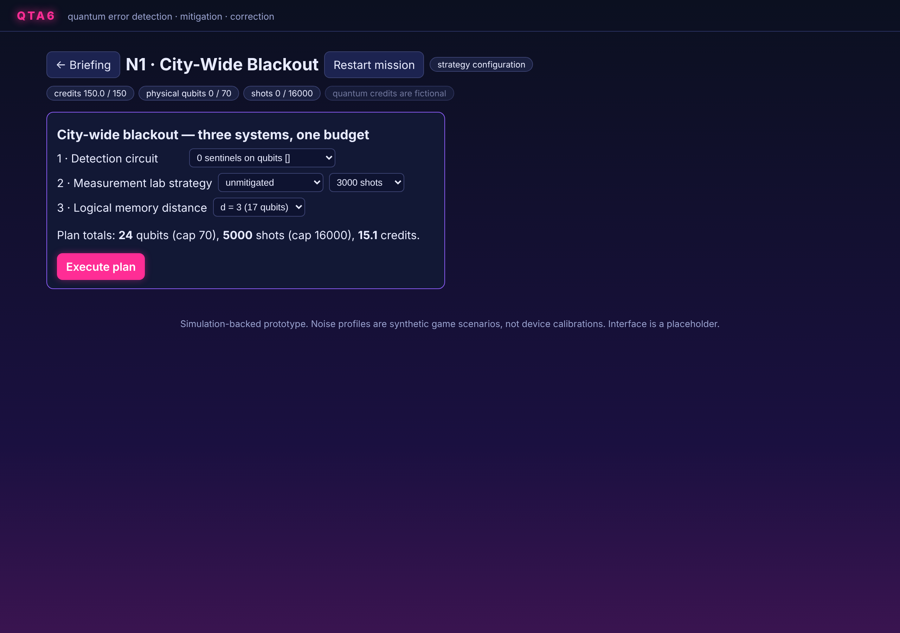

# QTA6

An interactive quantum error detection, mitigation and correction game for QuantumGrad Qiskit Fall Fest 2026 — McGill University Advanced Challenge.



## Project information

- **Competition:** QuantumGrad Qiskit Fall Fest 2026
- **Track:** Beyond — Advanced
- **Challenge:** McGill University — *Gamifying Quantum Error Detection, Mitigation and Correction*
- **Scientific focus:** Quantum Error Detection, Mitigation and Correction
- **Repository:** `quantumgrad`

## Status

- **Phase 0 — repository initialization:** complete.
- **Phase 1 — scientific research and literature review:** complete, preserved unchanged. See [`research/`](research/README.md).
- **Phase 2 + 3 — scientific engine, benchmarks and playable game:** implemented in this repository (details below).
- **Phase 4 — final visual/artistic production and submission materials:** **not started.** The current interface is a functional placeholder; the final artwork is not complete.

What exists: a Python scientific engine (Qiskit/Aer, qiskit-paulice, Stim, PyMatching), executed benchmarks with figures, a 29-mission browser game over precomputed simulation results, an optional FastAPI backend for live evaluation, tests and documentation. What does **not** exist: any quantum-hardware run (see [`docs/hardware_readiness.md`](docs/hardware_readiness.md)) and any final art. All noise models are **synthetic**, not measured device data.

## Competition context

The challenge asks for a game that teaches and explores error **detection**, **mitigation** and **correction** under noise and resource limits (inspired by the 2-D surface code). Two judging weightings are published and conflict; both are reproduced in [`research/01_official_challenge.md`](research/01_official_challenge.md):

| McGill prompt (PDF) | Weight | QuantumGrad event page | Weight |
|---|---|---|---|
| Qiskit | 10 % | Technical execution | 35 % |
| Methods | 20 % | Originality | 20 % |
| Effect | 30 % | Impact | 15 % |
| Presentation | 40 % | Presentation | 15 % |
| | | Personal work | 15 % |

Requirement-by-requirement mapping to code, tests and evidence: [`docs/implementation_traceability.md`](docs/implementation_traceability.md).

## Scientific foundations

Everything a player sees comes from an executed simulation; no formula lives in the frontend. Details: [`docs/scientific_engine.md`](docs/scientific_engine.md).

| Pillar | What is implemented |
|---|---|
| **Detection** | Spacetime Pauli checks via `qiskit-paulice` (stabilizer mode), exact density-matrix post-selection (`F_ps`, acceptance, overhead, detection/undetected-damage probabilities), independent Pauli propagation with signs, exact single-fault classification, Clifford vs Clifford+T (safe doping vs checks invalidated by blind T placement), explicit zero-acceptance handling |
| **Mitigation** | Readout calibration/inversion (negative quasi-probabilities never silently clipped), global-folding ZNE with Richardson/exponential extrapolation, uniform / Neyman / adaptive shot allocation, **fixed total-shot-budget** comparisons (calibration and pilot shots charged), bias–variance–MSE |
| **Correction** | Repetition code (Qiskit), rotated surface code d = 3, 5, 7 (Stim, circuit-level noise), MWPM (PyMatching), logical-failure statistics with Wilson/Clopper–Pearson intervals, qubit-round accounting, manual-decoding evaluator (valid → syndrome cleared → logical outcome, kept separate) |
| **Optimization** | `ResourceVector`/`Ledger` accounting, exact Pareto fronts, baselines (random, greedy, exhaustive, budget-aware, robust), regret, calibration-drift robustness |

Corrections to Phase 1 statements discovered during implementation are listed in [`docs/research_corrections.md`](docs/research_corrections.md).

## Gameplay

You are a quantum systems engineer in a fictional neon coastal city. **6 districts, 29 missions** (provisional names), a tutorial district, a hidden-fault diagnosis mission, a manual surface-code decoder, calibration drift, Pareto challenges and a final integrated mission (**N1 — City-Wide Blackout**) where detection, mitigation and correction share one budget.

| District | Focus | Missions |
|---|---|---|
| Quantum Academy | qubits, Pauli errors, statistics, repetition code | A1–A4 |
| Neon Labs | spacetime checks, post-selection, Clifford+T | D1–D6 |
| Sunset Bay | readout, ZNE, shot allocation, bias–variance | M1–M6 |
| Quantum Core | syndromes, surface code, matching, distance | C1–C8 |
| Circuit Harbor | limited resources, drift, Pareto | O1–O4 |
| Nexus Central | integrated budget | N1 |

Important honesty notes: campaign outcomes are **precomputed** by the engine for each discrete action (labelled as such in the UI) and replayed in the browser — the static build does not simulate quantum systems. The *Sandbox* (needs the API) evaluates new configurations live. Reference answers in the static bundle are **not secret**. Game credits are a fictional currency. Full design: [`docs/game_design.md`](docs/game_design.md), data contract: [`docs/game_data_contract.md`](docs/game_data_contract.md).

| | |
|---|---|
|  |  |
|  |  |

(Screenshots are real captures of the running placeholder interface; more in [`docs/screenshots/`](docs/screenshots).)

## Installation

Requires Python 3.12 and Node.js ≥ 20. No GPU.

```bash
python3.12 -m venv .venv && source .venv/bin/activate
pip install -r requirements-lock.txt && pip install -e . --no-deps
python -m qta6.cli doctor
```

```bash
cd frontend && npm install
```

## Run the game

```bash
cd frontend && npm run dev          # development server on http://127.0.0.1:5173
```

```bash
cd frontend && npm run build && npm run preview   # production build, http://127.0.0.1:4173
```

Optional live backend (sandbox mode):

```bash
uvicorn qta6.api.app:app --port 8000
```

## Reproduce results

```bash
python -m qta6.cli benchmark --profile smoke      # about 8 s
python -m qta6.cli benchmark --profile standard   # about 50 s on 4 cores
python -m qta6.cli export --profile standard      # regenerates frontend/public/data/campaign.json
python scripts/make_figures.py && python scripts/summarize_results.py
```

```bash
pytest                                              # 152 Python tests
cd frontend && npm run typecheck && npm test        # 22 frontend tests
```

Benchmark methodology: [`docs/benchmark_methodology.md`](docs/benchmark_methodology.md).

## Scientific results (standard profile, synthetic noise)

Full tables and figures: [`docs/benchmark_results.md`](docs/benchmark_results.md), [`results/`](results), [`docs/performance_report.md`](docs/performance_report.md). Highlights, including negative results:

* **Detection** (n = 4, depth 6, p₂ = 0.01, 4 checks, ancilla readout error 1 %): post-selected fidelity 0.9126 → 0.9583 while acceptance falls from 1.00 to 0.82. Largest gain in the sweep: +0.102 (p₂ = 0.02, κ = 0.71). At depth 2 the checks **do not help** (9 of 215 protected runs showed no benefit), and T gates placed without regard to the checks invalidate them.
* **Mitigation** (fixed total shots): in 77 of 252 benchmark cells the mitigated estimate was *worse* than doing nothing. Example (gate-dominated, 2000 shots): unmitigated MSE 1.9 × 10⁻³ vs Richardson-3 5.9 × 10⁻³. Adaptive allocation was worse than uniform at ≤ 2000 shots and better at ≥ 4000.
* **Correction** (logical failure per memory experiment, d = 3 → 5 → 7): p = 0.001: 8.5 × 10⁻⁴ → 1.8 × 10⁻⁴ → 1.7 × 10⁻⁵; p = 0.01: 5.9 × 10⁻² → 8.3 × 10⁻² → 1.0 × 10⁻¹. Distance helps below a crossover lying between p = 0.005 and 0.007 for this model and decoder; **no threshold value is claimed**.
* **Optimization:** under calibration drift a strategy chosen on stale knowledge showed 129 % regret; a robust choice 0 %. Optimality claims hold only inside the enumerated action spaces.

## Testing and CI

152 Python and 22 frontend tests pass locally (0 failed, 0 skipped); the production build succeeds. A GitHub Actions workflow ([`.github/workflows/ci.yml`](.github/workflows/ci.yml): Python doctor + tests + smoke benchmark + schema-validated export, and frontend `npm ci` + typecheck + tests + build) completed successfully for commit `765b069` ([run 46068464509](https://github.com/emreq3/quantumgrad/actions/runs/46068464509)). Later commits are covered by their own runs in the Actions tab. Report: [`docs/scientific_validation.md`](docs/scientific_validation.md).

## Known limitations

Synthetic noise only; no hardware execution; PEC, PNA/SLC, NoiseLearnerV3, dynamical decoupling, Pauli twirling, union-find / tensor-network decoders and correlated noise are not implemented; the extended benchmark profile was not run; placeholder visuals; no playtesting; accessibility not audited. See [`docs/known_limitations.md`](docs/known_limitations.md).

## Documentation

Phase 1 research: [`research/README.md`](research/README.md). Phase 2/3 documentation: [`docs/phase2_phase3_summary.md`](docs/phase2_phase3_summary.md) (index and acceptance table), [`architecture`](docs/architecture.md), [`scientific_engine`](docs/scientific_engine.md), [`game_design`](docs/game_design.md), [`frontend_and_api`](docs/frontend_and_api.md), [`environment`](docs/environment.md), [`dependency_audit`](docs/dependency_audit.md).

## AI assistance disclosure

The competition [terms](https://www.quantumgrad.com/qiskit-fall-fest-2026/terms) allow AI assistance and require a README disclosure describing roughly what it was used for. This section is updated for every phase.

**Phase 0 (repository initialization).** OpenAI Codex assisted by checking GitHub access, preparing this README, `.gitignore` and initial project-instruction and tool-configuration files (since removed at the project owner's request), and performing repository initialization and verification. No AI-generated scientific results, quantum algorithms, gameplay or visual assets were produced in that phase.

**Phase 1 (scientific research).** An AI coding assistant (a large language model used through an agentic coding tool in a cloud environment) was used to retrieve and read the official challenge material, look up public papers and documentation, check bibliographic metadata against the arXiv and Crossref APIs, draft all documents in `research/`, and audit them. It was not used to write game code, run simulations or create plots in that phase.

**Phase 2 and 3 (scientific engine, benchmarks and game).** The same kind of AI coding assistant **wrote the code, tests, benchmark and figure scripts, frontend, CI configuration, schemas and documentation** in this repository, ran the tests, benchmarks and a headless browser session, and generated the screenshots from the running prototype. All numbers in `results/` and `docs/benchmark_results.md` were produced by running that code on a cloud container; no result was typed in by hand and no hardware job was run. The commits are made under the project owner's Git identity, but the **work in them is AI-generated and must not be read as independently written by the team**. The team still has to review, understand and verify it (including the scientific claims and the research corrections in `docs/research_corrections.md`) before relying on or presenting it; the event rewards work that is substantially the team's own. The competition window is 27–29 November 2026 (deadline 17:00 CET on 29 November).
