# QTA6 — Quantum City

An interactive quantum error detection, mitigation and correction strategy game for QuantumGrad Qiskit Fall Fest 2026 — McGill University Advanced Challenge. Restore a fictional tropical coastal city's failing quantum network by choosing *how* to detect, mitigate and correct errors under limited qubits, shots and credits — every outcome comes from a simulation run by the project's scientific engine.

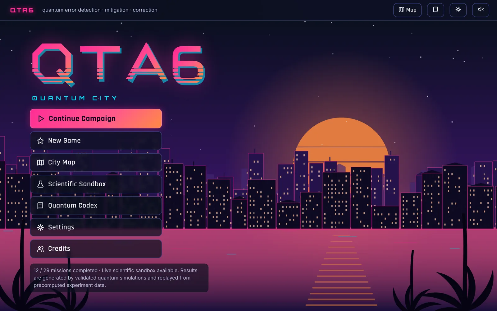

> **Live demo:** not deployed yet. The static build is ready and was verified under the GitHub Pages sub-path; it needs one admin setting (see [`docs/deployment.md`](docs/deployment.md)). Run it locally in two commands (below).

## Project information

- **Competition:** QuantumGrad Qiskit Fall Fest 2026 · **Track:** Beyond — Advanced · **Challenge:** McGill University — *Gamifying Quantum Error Detection, Mitigation and Correction*
- **Scientific focus:** Quantum Error Detection, Mitigation and Correction · **Repository:** `quantumgrad`
- **Fiction:** Quantum City is science fiction; the noise models are synthetic; no hardware was used.

## Status

| Phase | State |
|---|---|
| 0 — repository initialization | complete |
| 1 — scientific research and literature review | complete, preserved unchanged ([`research/`](research/README.md)) |
| 2 + 3 — scientific engine, benchmarks, playable game | complete ([`docs/phase2_phase3_summary.md`](docs/phase2_phase3_summary.md)) |
| 4 — quality audit, content overhaul, cinematic visual/audio production | implemented ([`docs/phase4_summary.md`](docs/phase4_summary.md)): original studio intro, redesigned menu/map/workspaces, narrative with six characters, staged finale, settings, credits, accessibility and responsive audits |

What is **not** done: any quantum-hardware run ([`docs/hardware_readiness.md`](docs/hardware_readiness.md)); GitHub Pages deployment (admin step); human playtesting; screen-reader testing; hand-painted final art and human sound design. See [`docs/known_limitations.md`](docs/known_limitations.md).

## Competition context

The challenge asks for a game that teaches and explores error **detection**, **mitigation** and **correction** under noise and resource limits (inspired by the 2-D surface code). Two judging weightings are published and conflict; both are reproduced in [`research/01_official_challenge.md`](research/01_official_challenge.md):

| McGill prompt (PDF) | Weight | QuantumGrad event page | Weight |
|---|---|---|---|
| Qiskit | 10 % | Technical execution | 35 % |
| Methods | 20 % | Originality | 20 % |
| Effect | 30 % | Impact | 15 % |
| Presentation | 40 % | Presentation | 15 % |
| | | Personal work | 15 % |

Requirement-by-requirement mapping to code, tests and evidence: [`docs/implementation_traceability.md`](docs/implementation_traceability.md).

## Gameplay

You are a quantum systems engineer in **Quantum City**. **6 districts, 29 missions**, six original characters, a manual surface-code decoder, calibration drift, Pareto challenges and a six-stage finale (**N1 — City-Wide Blackout**) in which detection, mitigation and correction share one budget and one execution; its ending (restored / partial / still down) follows the three real subsystem results.

| District | Pillar / focus | Missions | Contact |
|---|---|---|---|
| Quantum Academy | tutorial: measurement statistics, Pauli errors, repetition code | A1–A4 | Prof. Inés Valcourt |
| Neon Labs | detection: spacetime checks, post-selection, Clifford+T | D1–D6 | Dr. Soren Vale |
| Sunset Bay | mitigation: readout calibration, ZNE, shot allocation | M1–M6 | Mira "Dial" Castellanos |
| Quantum Core | correction: syndromes, surface code, matching, distance | C1–C8 | Axel Ndiaye |
| Circuit Harbor | optimization: budgets, drift, Pareto | O1–O4 | Capt. Odalys Brandt |
| Nexus Central | integrated finale | N1 | Commander Ravi Tessaly |

Menu: Continue Campaign (only with valid saved progress) · New Game · City Map · Scientific Sandbox · Quantum Codex · Settings · Credits. The campaign is **precomputed**: results are generated by validated quantum simulations and replayed from precomputed experiment data (labelled in the interface); the Sandbox runs **live** simulations when the optional API is running. Details: [`docs/game_design.md`](docs/game_design.md), [`docs/narrative_design.md`](docs/narrative_design.md), [`docs/art_direction.md`](docs/art_direction.md).

| | |
|---|---|
| 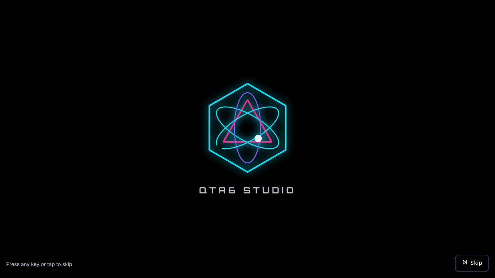 | 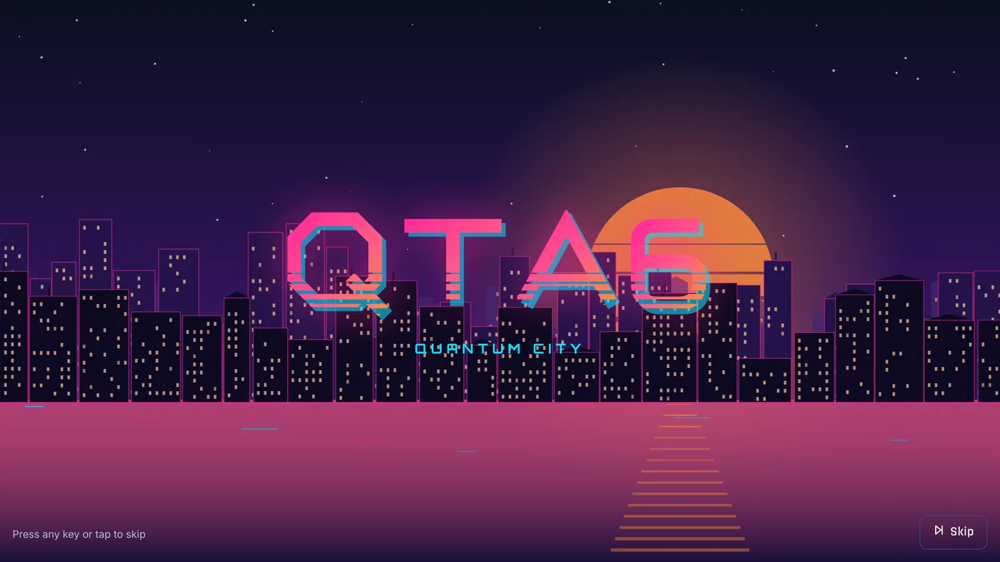 |
| 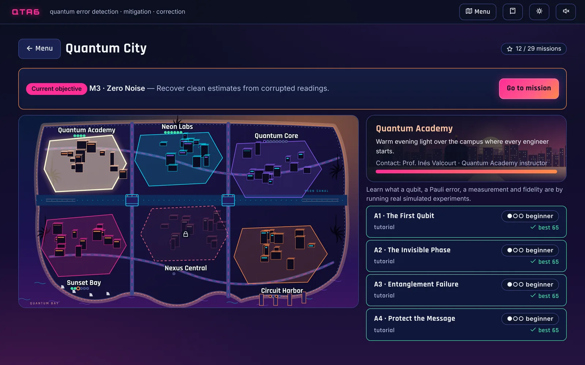 | 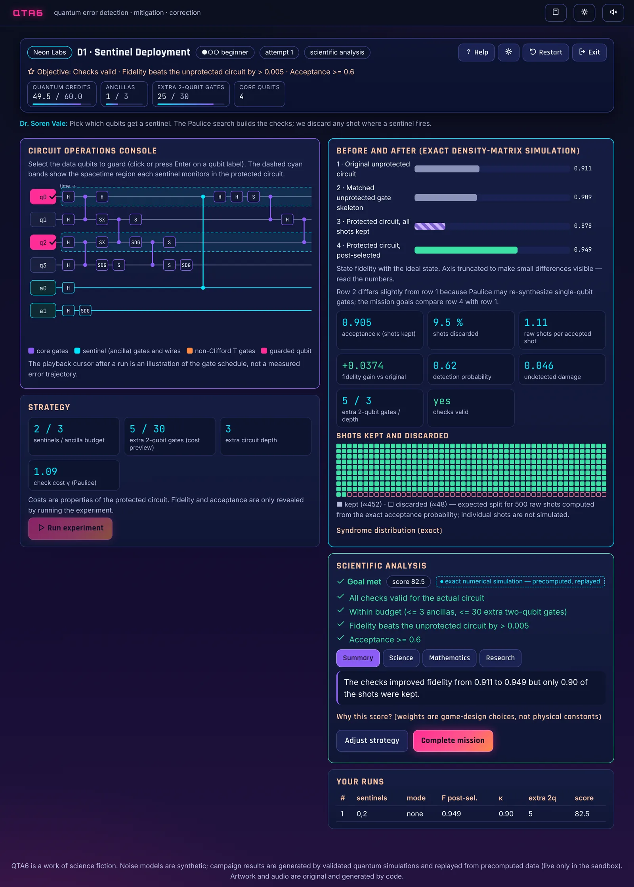 |
| 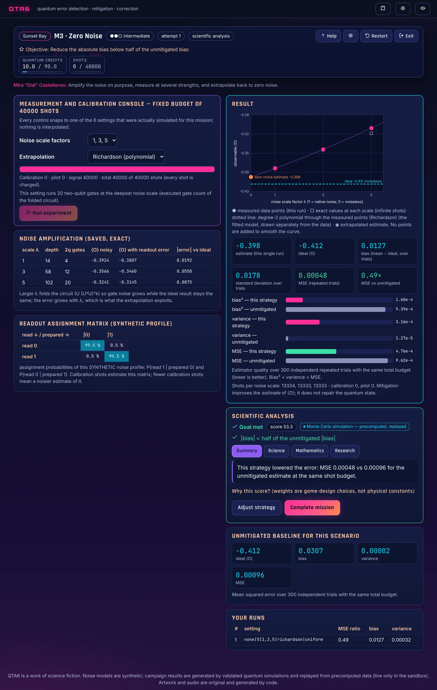 | 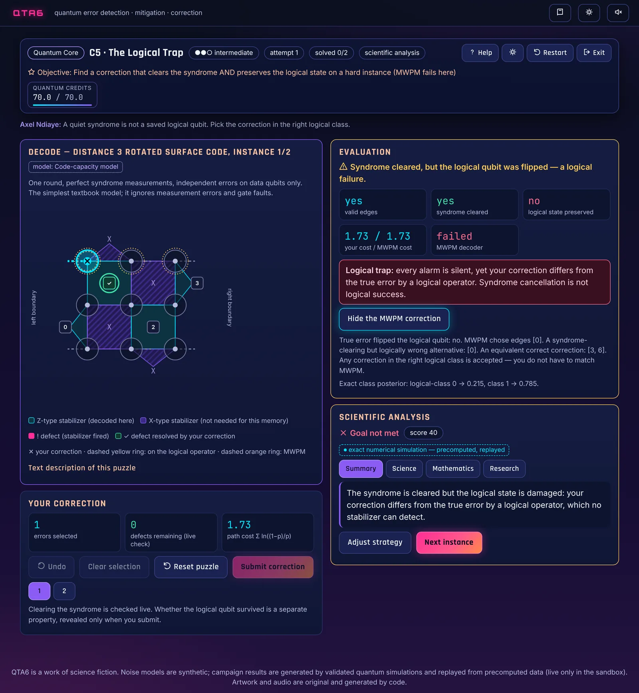 |
| 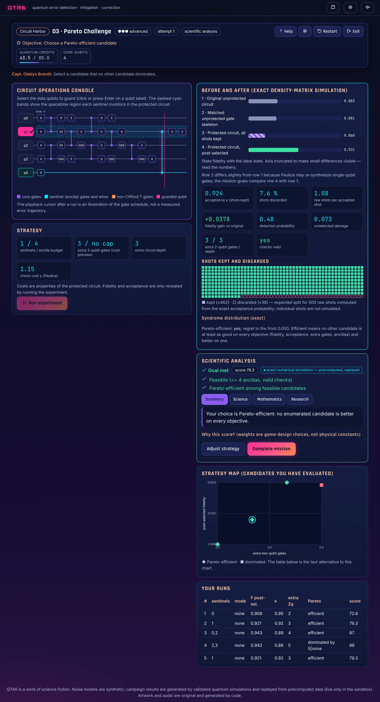 | 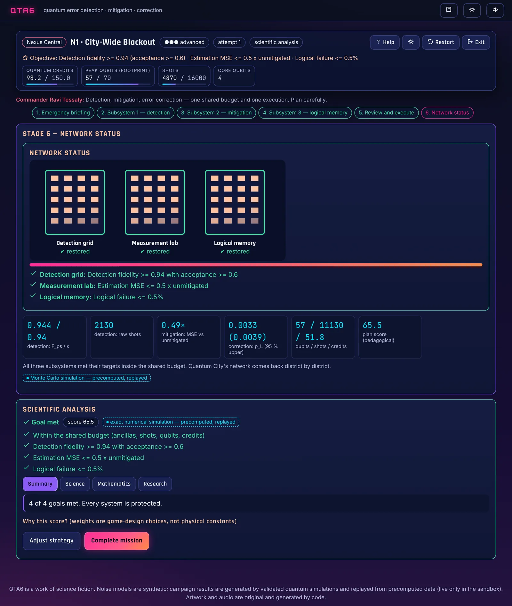 |
| 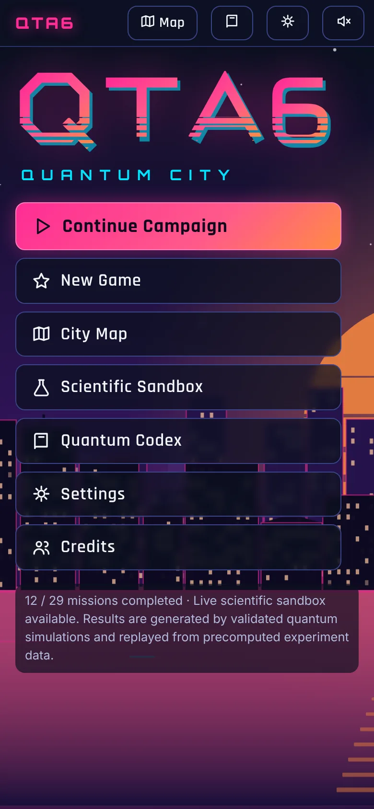 | 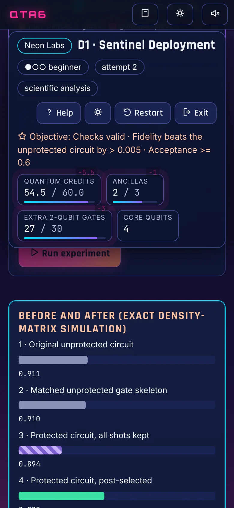 |

All screenshots are real captures of the production build ([`docs/screenshots/phase4/`](docs/screenshots/phase4), 24 images; captured with `frontend/e2e/screenshots.cjs`).

## Scientific foundations

Everything a player sees comes from an executed simulation; no formula lives in the frontend. Details: [`docs/scientific_engine.md`](docs/scientific_engine.md); corrections and caveats found along the way: [`docs/research_corrections.md`](docs/research_corrections.md), [`docs/phase4_scientific_audit.md`](docs/phase4_scientific_audit.md).

| Pillar | What is implemented |
|---|---|
| **Detection** | Spacetime Pauli checks via `qiskit-paulice` (stabilizer mode), exact density-matrix post-selection (`F_ps`, acceptance, discarded shots, overhead), four never-merged baselines (original circuit, matched skeleton, protected before post-selection, post-selected), independent Pauli propagation, exact single-fault classification, Clifford vs Clifford+T (safe doping vs checks invalidated by blind T placement), explicit zero-acceptance handling |
| **Mitigation** | Readout calibration/inversion (negative quasi-probabilities never silently clipped), global-folding ZNE with Richardson/linear extrapolation, uniform / Neyman / adaptive shot allocation, **fixed total-shot-budget** comparisons (calibration and pilot shots charged), bias–variance–MSE over repeated trials |
| **Correction** | Repetition code (Qiskit), rotated surface code d = 3, 5, 7 (Stim, circuit-level noise), MWPM (PyMatching), Wilson/Clopper–Pearson intervals, qubit-round accounting, manual decoding on code-capacity and phenomenological graphs (valid → syndrome cleared → logical outcome, kept separate) |
| **Optimization** | `ResourceVector`/`Ledger` accounting, exact Pareto fronts, baselines (random, greedy, exhaustive, budget-aware, robust), floored relative and absolute regret, calibration-drift robustness |

## Scientific results (standard profile, synthetic noise)

Full tables, figures and negative results: [`docs/benchmark_results.md`](docs/benchmark_results.md), [`results/`](results), [`docs/performance_report.md`](docs/performance_report.md). All were regenerated from a clean committed revision (`ca36e31`) and compared with the previous results: 140 035 values, 0 differences.

* **Detection** (n = 4, depth 6, p₂ = 0.01, 4 checks, 1 % ancilla readout error; mean over 5 payload seeds — *a documented configuration, not a guarantee*): post-selected fidelity 0.9126 → 0.9583 while acceptance falls to 0.82. At depth 2 the same checks do **not** help (9 of 215 protected runs), checks are noisy circuits (D1 `5|none`: 0.9112 original, 0.8777 protected *before* post-selection, 0.9486 after, acceptance 0.905), and T gates placed without regard to the checks invalidate 9 of 15 blind placements.
* **Mitigation** (fixed total shots): in 77 of 252 benchmark cells the mitigated estimate was *worse* than doing nothing. Gate-dominated, 2000 shots: unmitigated MSE 1.85 × 10⁻³, uniform 3-point Richardson 5.92 × 10⁻³, adaptive allocation 1.22 × 10⁻² (adaptive is 4.65× / 2.06× worse than uniform at 1000 / 2000 shots and better from 4000 shots on).
* **Correction** (logical failure per memory experiment, 95 % Wilson intervals; rounds = d / fixed 3 rounds):

  | p | d = 3 | d = 5 | d = 7 |
  |---|---|---|---|
  | 0.001, d rounds | 8.5 × 10⁻⁴ [6.5, 11] × 10⁻⁴ (51/60 000) | 1.8 × 10⁻⁴ [1.0, 3.3] × 10⁻⁴ (11) | 1.7 × 10⁻⁵ [0.29, 9.4] × 10⁻⁵ (**1** failure) |
  | 0.001, 3 rounds | 8.2 × 10⁻⁴ [7.0, 9.6] × 10⁻⁴ (164/200 000) | 6.5 × 10⁻⁵ [3.8, 11] × 10⁻⁵ (13) | 5.0 × 10⁻⁶ [0.88, 28] × 10⁻⁶ (**1** failure) |
  | 0.01, d rounds | 5.9 × 10⁻² | 8.3 × 10⁻² | 1.0 × 10⁻¹ |
  | 0.01, 3 rounds | 5.9 × 10⁻² | 4.9 × 10⁻² | 3.8 × 10⁻² |

  Larger distance helps at low error rates; where the ordering reverses **depends on the round policy**, so no threshold is claimed, and the d = 7 point at p = 0.001 rests on a single observed failure — the ≈ 51× ratio of point estimates is **not** a precise suppression factor.
* **Optimization:** under calibration drift a strategy chosen on stale knowledge showed 129 % regret; a robust choice 0 %. Optimality claims hold only inside the enumerated action spaces. Final mission N1: 768 executed plans, 512 feasible, 36 successful (random feasible plan mean score 55.4, greedy 67.4, best enumerated 67.4).

## Installation and execution

Requires Python 3.12 and Node.js ≥ 20. No GPU. Installation from the lock files was verified in an empty environment ([`docs/environment.md`](docs/environment.md)).

```bash
python3.12 -m venv .venv && source .venv/bin/activate
pip install -r requirements-lock.txt && pip install -e . --no-deps
python -m qta6.cli doctor
cd frontend && npm ci
```

**Offline campaign (no server, no API):**

```bash
cd frontend && npm run build && npm run preview     # production build on http://127.0.0.1:4173
```

```bash
cd frontend && npm run dev                          # development server on http://127.0.0.1:5173
```

**Live scientific sandbox** (optional; the Sandbox screen also accepts the address of any running API):

```bash
uvicorn qta6.api.app:app --port 8000
```

## Reproduce results and run the checks

```bash
python -m qta6.cli benchmark --profile smoke        # about 8 s
python -m qta6.cli benchmark --profile standard     # about 60 s on 4 cores
python -m qta6.cli export --profile standard        # regenerates frontend/public/data/campaign.json
python scripts/compare_results.py HEAD              # scientific regression against the committed results
python scripts/make_figures.py && python scripts/summarize_results.py
```

```bash
pytest                                              # 210 Python tests
cd frontend && npm run typecheck && npm test        # 99 frontend tests
cd frontend && npm run build && npm run e2e         # real-browser audits (Playwright/Chromium)
```

Reports: [`docs/browser_test_report.md`](docs/browser_test_report.md) (suites and counts), [`docs/campaign_validation.md`](docs/campaign_validation.md) (all 29 missions solvable and completed in a real browser), [`docs/accessibility_audit.md`](docs/accessibility_audit.md), [`docs/phase4_performance.md`](docs/phase4_performance.md).

## Testing and CI

210 Python and 99 frontend tests pass locally (0 failed, 0 skipped); the six browser audits pass: **29 / 29 missions completed through the UI**, 11 keyboard checks, 76 overflow-free screen/viewport combinations, 0 axe-core violations on 32 scans, audio engine running, sub-path loading. GitHub Actions ([`ci.yml`](.github/workflows/ci.yml): Python, frontend and browser jobs; [`pages.yml`](.github/workflows/pages.yml): deployment) — the status of runs is shown in the repository's Actions tab and is not asserted in this file.

## Known limitations

Synthetic noise only; no hardware execution; PEC, PNA/SLC, NoiseLearnerV3, dynamical decoupling, Pauli twirling, union-find / tensor-network decoders and correlated noise are not implemented; the manual decoder uses simplified models (named in the game); campaign outcomes are precomputed; reference answers are readable in the static JSON; no human playtest, no screen-reader test; art is procedural vector art and the audio has not been auditioned by a person; Pages is not deployed. See [`docs/known_limitations.md`](docs/known_limitations.md).

## Documentation

Phase 1 research: [`research/README.md`](research/README.md). Phase 2/3: [`docs/phase2_phase3_summary.md`](docs/phase2_phase3_summary.md). **Phase 4:** [`phase4_summary`](docs/phase4_summary.md) · [`baseline audit`](docs/phase4_baseline_audit.md) · [`bug register`](docs/phase4_bug_register.md) · [`scientific audit`](docs/phase4_scientific_audit.md) · [`content review`](docs/phase4_content_review.md) · [`narrative`](docs/narrative_design.md) · [`art direction`](docs/art_direction.md) · [`asset manifest`](docs/asset_manifest.md) · [`accessibility`](docs/accessibility_audit.md) · [`browser tests`](docs/browser_test_report.md) · [`campaign validation`](docs/campaign_validation.md) · [`deployment`](docs/deployment.md) · [`performance`](docs/phase4_performance.md). Architecture and engine: [`architecture`](docs/architecture.md), [`scientific_engine`](docs/scientific_engine.md), [`frontend_and_api`](docs/frontend_and_api.md), [`game_data_contract`](docs/game_data_contract.md), [`environment`](docs/environment.md), [`dependency_audit`](docs/dependency_audit.md).

## Credits, artwork and audio attribution

Built for QuantumGrad Qiskit Fall Fest 2026 (McGill Advanced Challenge). All artwork is **original procedural SVG generated by code** and all sound is **synthesised in the browser**; bundled third-party assets are the Orbitron, Rajdhani, Inter and JetBrains Mono fonts (SIL Open Font License 1.1). No project license has been chosen yet (all rights reserved by the project owner until one is added). QTA6 is an independent project: it is **not affiliated with, endorsed by or derived from Rockstar Games, Take-Two Interactive or any Grand Theft Auto title**, and uses none of their assets, names, logos, lettering, maps, characters or music. Inventory: [`docs/asset_manifest.md`](docs/asset_manifest.md).

## AI assistance disclosure

The competition [terms](https://www.quantumgrad.com/qiskit-fall-fest-2026/terms) allow AI assistance and require a README disclosure describing roughly what it was used for. This section is updated for every phase.

**Phase 0 (repository initialization).** OpenAI Codex assisted by checking GitHub access, preparing this README, `.gitignore` and initial project-instruction and tool-configuration files (since removed at the project owner's request), and performing repository initialization and verification. No AI-generated scientific results, quantum algorithms, gameplay or visual assets were produced in that phase.

**Phase 1 (scientific research).** An AI coding assistant (a large language model used through an agentic coding tool in a cloud environment) was used to retrieve and read the official challenge material, look up public papers and documentation, check bibliographic metadata against the arXiv and Crossref APIs, draft all documents in `research/`, and audit them. It was not used to write game code, run simulations or create plots in that phase.

**Phase 2 and 3 (scientific engine, benchmarks and game).** The same kind of AI coding assistant **wrote the code, tests, benchmark and figure scripts, frontend, CI configuration, schemas and documentation** in this repository, ran the tests, benchmarks and a headless browser session, and generated the screenshots from the running prototype. All numbers in `results/` and `docs/benchmark_results.md` were produced by running that code on a cloud container; no result was typed in by hand and no hardware job was run. The commits are made under the project owner's Git identity, but the **work in them is AI-generated and must not be read as independently written by the team**. The team still has to review, understand and verify it (including the scientific claims and the research corrections in `docs/research_corrections.md`) before relying on or presenting it; the event rewards work that is substantially the team's own. The competition window is 27–29 November 2026 (deadline 17:00 CET on 29 November).

**Phase 4 (quality audit, content overhaul, visual and audio production, validation).** The same kind of AI coding assistant, working directly in this repository, **audited the Phase 3 game and fixed the defects it found** (an unwinnable mission, free wins, uncharged budgets, a crash with blocked storage, keyboard-inaccessible controls — all listed in [`docs/phase4_bug_register.md`](docs/phase4_bug_register.md)); **wrote the narrative, characters and dialogue; generated all artwork as procedural SVG code** (logo, studio emblem, skylines, district scenes, city map, portraits, icons) and **the Web Audio sound identity**; redesigned the interface; wrote the new tests and the browser audit scripts; ran them in a headless Chromium; captured the screenshots from the running application; regenerated and compared the benchmark results; and wrote the Phase 4 documentation. **No image-generation or audio-generation model was used, no image was downloaded, no hardware job was run, and no result was typed in by hand.** Nobody has listened to the audio or played the game as a human tester: the automated playthroughs are not user studies. The commits are authored under the project owner's Git identity, but the **work in them is AI-generated and must not be read as independently written by the team**; the team must review, understand and verify it (including the scientific claims in [`docs/phase4_scientific_audit.md`](docs/phase4_scientific_audit.md)) before relying on or presenting it. The studio label in the intro is a neutral placeholder ("QTA6 STUDIO"); no team or studio name was assumed.
