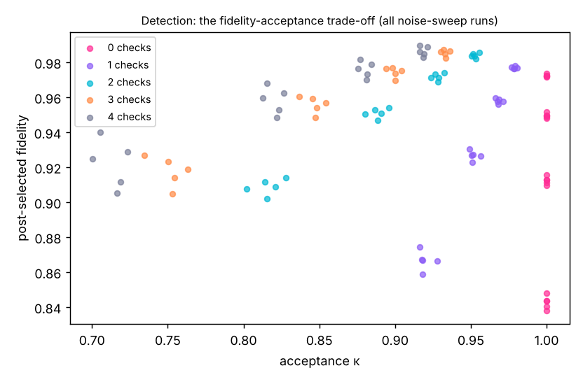
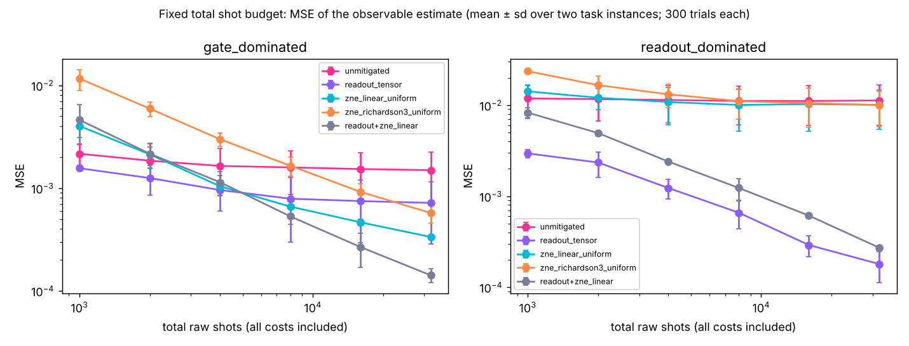
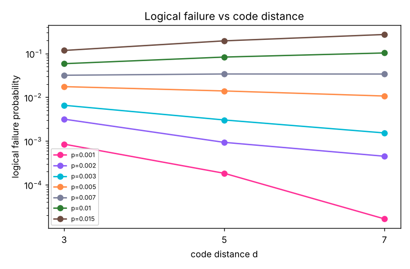

# QTA6 — Quantum City: a game about spending a quantum error budget

*Competition entry write-up (Markdown). QuantumGrad Qiskit Fall Fest 2026 · Beyond (Advanced) · McGill University challenge "Gamifying Quantum Error Detection, Mitigation and Correction". This text is a draft for the team to review and sign off; see "AI assistance" below.*

## 1. Motivation

Quantum hardware is noisy, and there is no single remedy. **Error detection** discards runs that a check flags, **error mitigation** post-processes many noisy runs into a better estimate, and **error correction** spends many physical qubits to protect a logical one. Each costs something different: shots, extra gates and qubits, or qubit-rounds. People new to the field rarely see these trade-offs side by side, and the three tools are usually taught separately. QTA6 puts all three in one place and makes the *budget* the thing you play with.

## 2. Problem and approach

The player is an engineer in a fictional city (Quantum City, science fiction — nothing about it is real) whose quantum network is failing. Six districts hold 29 missions: a tutorial on measurement statistics and the repetition code, then one district per pillar, a resource-optimisation district, and a final mission that must satisfy all three pillars on one shared budget.

The design rule is that **the game never invents a number.** The scientific engine (Python: Qiskit/Aer, `qiskit-paulice`, Stim, PyMatching) simulates every action that a mission allows; the browser game replays those precomputed outcomes. A mission's constraints, success conditions, resource costs, feedback text and score are generated from the same data, and an automated check plays a winning strategy through every mission, so none can be unwinnable. Only the Sandbox screen computes live (through an optional local API).

## 3. The three pillars

**Detection** — spacetime Pauli checks (sentinel ancillas) placed by Paulice; exact density-matrix simulation gives the post-selected fidelity, the acceptance probability κ and the overhead `1/κ`. The game shows four baselines separately (original circuit, matched unprotected skeleton, protected without post-selection, protected with post-selection) so that the benefit of the checks is never confused with the noise they add. Negative results are kept and taught: in shallow circuits the checks can lower the fidelity; blind T-gate placement invalidates checks.



**Mitigation** — readout calibration with inversion (negative estimates are *not* clipped), zero-noise extrapolation by global folding with Richardson or linear extrapolation, and shot allocation (uniform, adaptive with a paid pilot). Everything is compared at an **equal total shot budget** including calibration and pilot shots. The key lesson is measured, not asserted: in 77 of 252 benchmark cells the "mitigated" estimate had a *larger* error than doing nothing, because extrapolation amplifies shot noise by `Σγᵢ²` (5/2 for scales 1,3; 167/32 for 1,3,5).



**Correction** — the repetition code (exact) and the rotated surface code at distance 3, 5 and 7 under circuit-level noise (Stim, decoded with PyMatching). In the game the player decodes by hand on a lattice: connect the defects, clear the syndrome, then learn that **a quiet syndrome is not a saved qubit** (a correction can clear every alarm and still flip the logical qubit). The manual decoder uses code-capacity (and, in one mission, phenomenological) noise; the distance mission and the benchmarks use the full circuit-level model.



## 4. Optimisation and the integrated challenge

Resources are tracked by a ledger (ancillas, extra gates, shots, qubit-rounds, qubits, credits). Missions ask for Pareto-efficient plans, for decisions under calibration drift (a strategy that wins on stale data had 129 % regret under the true noise; a robust choice had 0 %), and for the final mission **N1 — City-Wide Blackout**, a six-step plan (inspect, choose detection, mitigation and correction, review resources, execute once). N1 has 768 executed plans; 512 are feasible and only 36 meet all three scientific targets, so the budget genuinely constrains the choice. The three outcomes are shown separately next to a pedagogical score whose weights are game-design choices, not physical constants.

## 5. How the game teaches

Each screen has three levels: a **Game view** (objective, resources, one action, a simple result), **Scientific details** one click away (baselines, estimator statistics, derivations), and a **Codex with a research mode** (definitions with their equations and assumptions). Mathematics is typeset with KaTeX from LaTeX in the engine's data, so the formula a player sees is the formula the engine used. A **Quick Demo** of six curated missions (about one idea per pillar, ending with the integrated challenge) gives a short path through the whole design; its progress is stored apart from the campaign.


## 6. What was verified (and what was not)

* The engine's physics is checked against analytic and exhaustive references (hundreds of tests); every committed benchmark is regenerated and compared with no tolerance loosened.
* All 29 missions are completed through the real user interface in Chromium, and representative missions plus the final mission in Firefox and WebKit (Playwright builds; "WebKit" is not Safari). Keyboard-only play, responsive layouts and an axe-core scan are automated; numbers are in `phase5_browser_validation.md` and `phase5_accessibility.md`.
* Small additional experiments with exact checks (probabilistic error cancellation in a toy model, Pauli twirling, exact maximum-likelihood/MWPM/union-find comparison for the code-capacity surface code) are in `phase5_scientific_extensions.md`; none feeds the game.
* **Not done:** no human playtest, no human listening review of the (algorithmic) soundtrack, no screen-reader or physical-device test, no hardware run, no formal accessibility conformance claim. Materials for the first two are in `human_playtest_protocol.md` and `audio_listening_checklist.md`.

## 7. Originality — stated carefully

Our literature review (`research/10_competitive_landscape.md`, `11_research_gaps.md`) found games for individual pieces (manual decoding, surface-code puzzles) but, in the sources we read, no game that puts detection, mitigation and correction on one shared budget with an exact reference for each. That is a statement about the sources we read, **not** a proof of novelty. We do not claim that the game teaches better than alternatives; that would need a study we have not run.

## 8. Limitations

Synthetic noise only; no real-device data; the campaign is precomputed (the browser does not simulate); the manual decoder is simplified relative to hardware decoders; distance-7 low-error-rate results rest on very few observed failures (reported with Wilson intervals); the crossover between code distances depends on the round policy, so **no threshold is claimed**; optimality is relative to the enumerated action spaces. The full list: `known_limitations.md`; every quantitative claim with its method and caveat: `scientific_claims_register.md`.

## 9. Future work

A human playtest and listening review; a real-hardware adapter (an isolated environment and a fake-backend run exist: `iqm_adapter.md`; hardware needs the owner's credentials and budget); more extensions (dynamical decoupling with a justified noise model, correlated noise, more decoders); an extended benchmark profile; an installable offline version.

## 10. Reproducibility

```bash
python3.12 -m venv .venv && source .venv/bin/activate
pip install -r requirements-lock.txt && pip install -e . --no-deps
python -m qta6.cli benchmark --profile standard && python scripts/compare_results.py HEAD
cd frontend && npm ci && npm run build && npm run preview        # play at http://127.0.0.1:4173
```

Checks: `pytest`, `npm test`, `npm run e2e` (Chromium; set `QTA6_BROWSER=firefox` or `webkit` for the others). Seeds, versions and data files are recorded with every result; the campaign data are generated offline and replayed, and every difference between two regenerations is wall-clock time only (`scripts/campaign_diff.py`).

## 11. AI assistance (as disclosed in the README)

This repository's code, tests, scripts, documentation, artwork (procedural SVG) and audio (Web Audio synthesis) were produced by an AI coding assistant working in the repository under the project owner's Git identity; the team must review, understand and verify the work before presenting it as its own. No image- or audio-generation model was used, and no result was typed in by hand.
