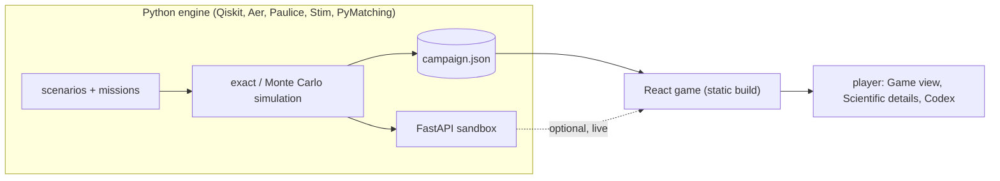

# Demo script, Quick Demo walkthrough and presentation outline

No video was produced (no screen-recording tool was run). Everything below can be performed live from the production build (`cd frontend && npm run build && npm run preview`, or the hosted site if the owner has enabled Pages). Timings are **estimates for a presenter who knows the game**, not measurements with players; the automated play-through of the Quick Demo takes about 4 s because a script does not think.

## A. Three-minute judge demo (spoken)

| t | show | say |
|---|---|---|
| 0:00 | Title screen (skip the intro with Esc; sound is off by default) | "QTA6 is a game about spending a *quantum error budget*. Three tools — detection, mitigation, correction — each cost something different." |
| 0:15 | **Quick Demo** → step 1 (A2) | "One idea per step. A simple error: it is invisible in the wrong measurement basis." Pick the X basis, Measure. |
| 0:45 | Step 2 (D1 detection) | "Sentinel checks discard shots. Fidelity goes up, acceptance goes down — we show both." Place two sentinels, Execute. Open **Scientific details**: "four separate baselines, so the benefit is never confused with the noise the checks add." |
| 1:15 | Step 3 (M2 mitigation) | "Same shot budget for everything, including calibration. Mitigation can lose to doing nothing; the game lets you find that out." |
| 1:45 | Step 4 (C3 decoding) | "Connect the defects. The syndrome clears — but is the qubit saved? Submit and see." (Optionally C5 for the logical trap.) |
| 2:15 | Step 6 (N1) | "One shared budget, six steps, one execution. Three outcomes are judged separately." Show the confirm dialog, then the restoration board. |
| 2:45 | Codex → Research mode | "The equation on screen is the one the engine used; every claim and its caveat is in `scientific_claims_register.md`." |

## B. Quick Demo walkthrough (what each step teaches and one winning move)

| step | mission | idea | a winning move |
|---|---|---|---|
| 1 | A2 The Invisible Phase | errors can be invisible in one basis | measure in the X basis (any of the offered shot counts meets the goal; more shots narrow the interval) |
| 2 | D1 Sentinel Deployment | detection trades shots for fidelity | two sentinels on qubits 0 and 2 (fidelity 0.911 → 0.949, acceptance 0.90) |
| 3 | M2 Shot Budget | calibration vs signal split | a calibration share between 2 % and 40 % (1 % is too thin to trust) |
| 4 | C3 Connect the Defects | decode by hand; check the logical qubit | connect the defects with the minimum-weight correction |
| 5 | C6 Distance Decision | distance vs qubit budget vs failure target | the distance that fits the qubit budget *and* whose 95 % upper bound meets the target (d = 5) |
| 6 | N1 City-Wide Blackout | integrated plan on one budget | any of the 36 winning plans; each subsystem is judged by its own target |

(Hints are in the game: **Hint** button on every mission. The moves above come from the campaign data that the automated playthrough uses.)

## C. Presentation outline (10 slides)

1. **The problem** — noisy hardware; three remedies with different costs.
2. **Why it matters** — people see these trade-offs separately; a budget makes them comparable.
3. **The idea** — a city, 29 missions, one shared budget.
4. **How the game is built** — engine simulates every allowed action; the browser replays them (diagram below).
5. **Detection** — four baselines; negative results kept (figure: `results/figures/detection_fidelity_vs_acceptance.png`).
6. **Mitigation** — equal-budget comparison; 77/252 cells worse than doing nothing (figure: `mitigation_mse_vs_shots.png`).
7. **Correction** — decode by hand; a quiet syndrome is not a saved qubit; distance depends on the round policy (figure: `correction_logical_vs_distance.png`).
8. **The integrated challenge** — N1: 768 plans, 512 feasible, 36 successful.
9. **How we checked it** — physics tests, regenerated benchmarks, all missions through the UI in three browser engines, accessibility checks; what we did *not* do (human playtest, listening review, hardware).
10. **Limits and next steps** — synthetic noise, simplified manual decoder, no threshold claim; human review, hardware adapter, more decoders.

Figures: the six real plots above plus the Phase 5 screenshots in `docs/screenshots/phase5/`. Key numbers and their caveats: `scientific_claims_register.md`.

### Architecture diagram

## D. Team contribution checklist (to be filled by the team; do not pre-fill)

- [ ] Each member has run the game and can explain detection, mitigation and correction in one sentence.
- [ ] Each member has read `scientific_claims_register.md` and can state one caveat per pillar.
- [ ] Who presents which slide; who answers questions on the engine, the game and the verification.
- [ ] Who reviewed the AI-assistance disclosure in the README and the write-up.
- [ ] Who ran (or will run) the human playtest and the listening review.
